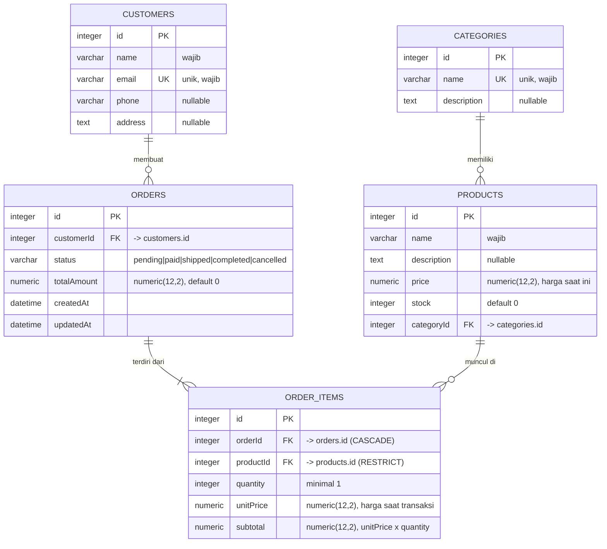

# Desain Sistem & ERD — E-commerce Management System

## 1. Kebutuhan Fungsional

| Kode | Kebutuhan |
|------|-----------|
| F1 | Mengelola (tambah, lihat, ubah, hapus) data **kategori** produk |
| F2 | Mengelola data **produk** beserta kategori, harga, dan stok |
| F3 | Mengelola data **pelanggan** |
| F4 | Membuat, melihat, memperbarui, dan menghapus **pesanan** sesuai aturan bisnis |
| F5 | Menyimpan **detail item** pesanan (produk, kuantitas, harga saat transaksi) |
| F6 | Menampilkan detail pesanan beserta data pelanggan dan informasi produk terkait |

## 2. Aturan Bisnis

| Kode | Aturan |
|------|--------|
| B1 | Nama kategori unik; email pelanggan unik (konflik → `409`). |
| B2 | Setiap produk wajib memiliki kategori yang ada. Harga ≥ 0 (maks. 2 desimal), stok bilangan bulat ≥ 0. |
| B3 | Pesanan wajib memiliki pelanggan yang ada dan minimal 1 item. Kuantitas item ≥ 1. |
| B4 | Saat pesanan dibuat, **stok produk dikurangi**. Jika stok tidak cukup, seluruh pesanan ditolak (`400`) dan tidak ada stok yang berubah (transaksi database). |
| B5 | **Harga satuan disalin** ke detail pesanan (`unitPrice`) saat transaksi. Perubahan harga produk di kemudian hari tidak mengubah pesanan lama. |
| B6 | Item produk yang sama dalam satu permintaan digabung (kuantitas dijumlah) sebelum cek stok. |
| B7 | `totalAmount` pesanan = jumlah `subtotal` seluruh item (`unitPrice × quantity`), dihitung server. |
| B8 | Item pesanan hanya dapat diubah saat status `pending`. Stok lama dikembalikan, lalu stok baru dikurangi. |
| B9 | Alur status: `pending → paid → shipped → completed`. Pembatalan (`cancelled`) hanya dari `pending` atau `paid` dan **mengembalikan stok**. Transisi lain → `409`. |
| B10 | Pesanan hanya dapat dihapus saat `pending` (stok dikembalikan) atau `cancelled`. Status lain → `409`. |
| B11 | **Integritas relasi:** kategori yang masih punya produk, produk yang pernah dipakai di detail pesanan, dan pelanggan yang masih punya pesanan **tidak dapat dihapus** (`409`). Menghapus pesanan ikut menghapus detail itemnya. |

## 3. ERD

### Penjelasan relasi

| Relasi | Kardinalitas | Foreign key | Perilaku hapus |
|--------|--------------|-------------|----------------|
| Categories → Products | 1 : N | `products.categoryId` | `RESTRICT` (kategori tidak dapat dihapus jika masih punya produk) |
| Customers → Orders | 1 : N | `orders.customerId` | `RESTRICT` |
| Orders → OrderItems | 1 : N | `order_items.orderId` | `CASCADE` (item ikut terhapus bersama pesanan) |
| Products → OrderItems | 1 : N | `order_items.productId` | `RESTRICT` (produk yang pernah dipesan tidak dapat dihapus) |
| **Orders ↔ Products** | **N : M** | via tabel penghubung `order_items` | — |

`order_items` adalah **tabel penghubung** relasi many-to-many antara `orders` dan `products`. Tabel ini juga membawa atribut sendiri (`quantity`, `unitPrice`, `subtotal`), sehingga bukan sekadar pasangan foreign key.

Total: **5 entitas** dan **4 relasi** (3 relasi one-to-many langsung + 1 many-to-many lewat tabel penghubung).

## 4. Pemetaan ke Kode

| Entitas | File entity |
|---------|-------------|
| Category | `src/categories/entities/category.entity.ts` |
| Product | `src/products/entities/product.entity.ts` |
| Customer | `src/customers/entities/customer.entity.ts` |
| Order | `src/orders/entities/order.entity.ts` |
| OrderItem | `src/order-items/entities/order-item.entity.ts` |
